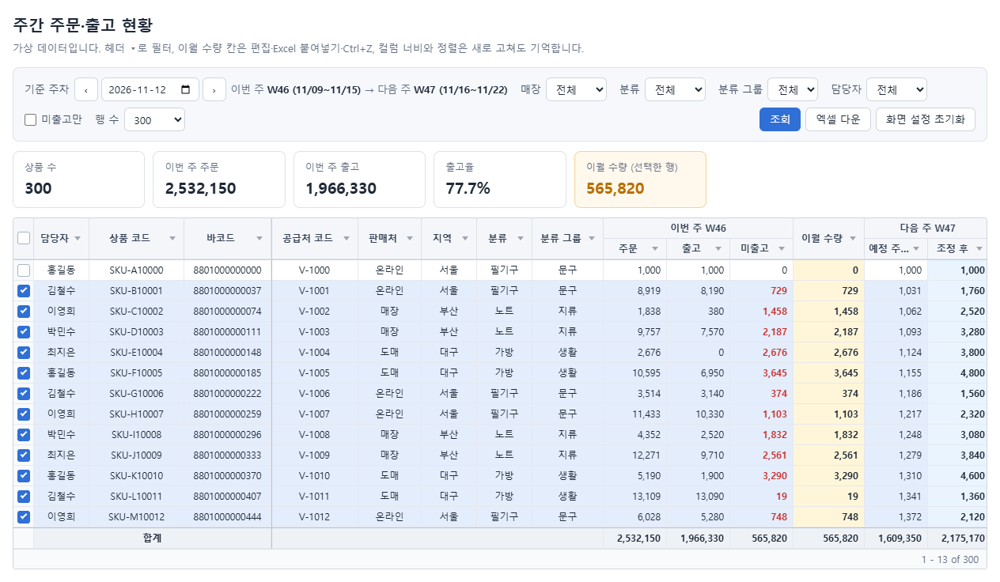

# pyogrid

**[웹사이트](https://herbcookey.github.io/pyogrid/README.ko.html)** · **[데모](https://herbcookey.github.io/pyogrid/demo/)** · [npm](https://www.npmjs.com/package/pyogrid) · [변경 기록](CHANGELOG.md) · [English](README.md)

외부 라이브러리 없이 동작하는 순수 JavaScript 데이터 그리드입니다. 수만 행을 가상 스크롤로 보여 주고, 엑셀처럼 셀을 고르고 바로 입력하는 편집을 지원합니다. 셀을 고르고 그냥 치면 한글도 첫 글자부터 들어가고, 조합 중에 누른 Enter 한 번으로 저장됩니다.

- 의존성 없음. xlsx 내보내기만 [SheetJS](https://sheetjs.com/)가 있을 때 씁니다.
- `<script>` 태그 하나(전역 `PyoGrid`)로 쓰거나 ES 모듈로 가져옵니다.
- 프레임워크와 관계없이 씁니다 (React, Vue, Angular, 또는 프레임워크 없이).
- 지원 브라우저: Chrome, Edge, Firefox, Safari 최신. 자동 테스트는 Windows의 Chrome, Firefox, WebKit(Safari 엔진)에서 합니다.
- 기본 문구는 영어입니다. 한국어 화면은 `locale: "ko"`를 넣으세요 ([한국어 화면 문구](#한국어-화면-문구)).



옵션, 컬럼 정의, 메서드, 이벤트 같은 상세 레퍼런스는 영어 문서([README.md](README.md))에만 있습니다. 아래 [자세한 문서](#자세한-문서)에 절별 링크를 모아 두었습니다.

데모는 **[herbcookey.github.io/pyogrid/demo/](https://herbcookey.github.io/pyogrid/demo/)** 에서 바로 써 볼 수 있습니다.

## 목차

- [주요 기능](#주요-기능)
- [설치](#설치)
- [빠른 시작](#빠른-시작)
- [한글 입력](#한글-입력)
- [한국어 화면 문구](#한국어-화면-문구)
- [자세한 문서](#자세한-문서)
- [라이선스](#라이선스)

## 주요 기능

- **가상 스크롤:** 보이는 행과 열만 DOM에 그립니다. 50,000행 × 30열을 만들고 데이터를 넣는 데 20~50ms 걸립니다.
- **틀 고정과 다단 헤더:** 헤더, 고정 컬럼, 합계 행이 `position: sticky`로 붙어 있어서 스크롤할 때 밀리지 않습니다.
- **바로 입력:** 셀을 고르고 치면 그 자리에서 편집이 시작됩니다. 한글 조합이 끊기지 않습니다.
- **편집기 6종:** text, number, money, date(달력), select, checkbox. 직접 만든 편집기도 등록할 수 있습니다.
- **엑셀식 복사·붙여넣기:** 범위를 탭으로 나눈 글자로 복사하고 붙입니다. 채우기·반복 규칙이 엑셀과 같고, 붙인 값도 입력할 때와 같은 검증을 거칩니다.
- **실행 취소·다시 실행:** 셀 편집, Delete, 붙여넣기, 잘라내기를 되돌립니다.
- **변경 추적:** 수정·추가·삭제된 행을 모아 줍니다. 값을 처음대로 되돌리면 수정된 행에서 빠집니다.
- **헤더 값 필터:** 엑셀 자동 필터처럼 값 목록에서 고르고, 전체 값에서 검색합니다.
- **합계 행, 그룹 합계, 트리, 셀 병합**
- **선택 합계:** 고른 셀의 개수·합계·평균을 아래 바에 보여 줍니다.
- **서버 페이징·서버 정렬**
- **xlsx 내보내기:** 화면 그대로, 병합 헤더와 숫자 셀을 살려 내보냅니다.
- **컬럼 너비·정렬 기억:** 화면별로 `localStorage`에 저장합니다.
- **테마:** CSS 변수로 색을 바꿉니다. TypeScript 선언 파일이 들어 있습니다.
- **화면 문구:** 영어가 기본이고 한국어가 들어 있습니다. 모든 기본 문구를 바꿀 수 있습니다.

## 설치

```bash
npm install pyogrid
```

```js
import { PyoGrid } from "pyogrid";
import "pyogrid/css"; // 번들러(Vite, webpack 등)에서 CSS 불러오기
```

빌드 도구 없이 CDN으로 쓸 수도 있습니다. JSP·PHP처럼 번들러가 없는 화면에서는 이 두 줄이면 됩니다.

```html
<link rel="stylesheet" href="https://cdn.jsdelivr.net/npm/pyogrid@0.9/dist/pyogrid.min.css">
<script src="https://cdn.jsdelivr.net/npm/pyogrid@0.9/dist/pyogrid.min.js"></script>
```

unpkg에도 같은 파일이 있습니다 (`https://unpkg.com/pyogrid@0.9/dist/...`). 운영 화면에서는 주소에 버전(`@0.9` 또는 `@0.9.0`처럼 정확한 버전)을 꼭 넣으세요. 버전을 빼면 항상 최신 버전을 받으므로, 사용법이 바뀌는 새 버전이 나오면 화면이 깨질 수 있습니다.

엑셀 내보내기를 쓰려면 SheetJS를 그리드보다 먼저 불러옵니다.

```html
<script src="https://cdn.sheetjs.com/xlsx-0.20.3/package/dist/xlsx.full.min.js"></script>
```

배포 파일 목록과 소스에서 빌드하는 방법은 영어 문서의 [Installation](README.md#installation)과 [Development](README.md#development)를 보세요.

## 빠른 시작

```html
<link rel="stylesheet" href="https://cdn.jsdelivr.net/npm/pyogrid@0.9/dist/pyogrid.min.css">
<script src="https://cdn.jsdelivr.net/npm/pyogrid@0.9/dist/pyogrid.min.js"></script>

<div id="grid" style="height: 400px"></div>

<script>
  var grid = new PyoGrid(document.getElementById("grid"), {
    locale: "ko",               // 기본 문구를 한국어로 (기본은 영어)
    rowSelector: true,         // 왼쪽 행 선택 체크박스
    frozenColumns: 2,          // 왼쪽 2개 컬럼 틀 고정
    sortable: true,            // 헤더 클릭 정렬
    headerAlign: "center",
    columns: [
      { key: "SKU", label: "상품 코드", width: 120, align: "center" },
      { key: "NAME", label: "상품명", width: "*" },
      { label: "이번 주", columns: [                       // 다단 헤더
        { key: "QTY", label: "수량", width: 80, align: "right", formatter: "money",
          editor: { type: "number" } },
        { key: "AMT", label: "금액", width: 100, align: "right", formatter: "money" }
      ] }
    ],
    footSum: [[
      { label: "합계", colspan: 2, align: "center" },
      { key: "QTY", collector: "sum", formatter: "money", align: "right" },
      { key: "AMT", collector: "sum", formatter: "money", align: "right" }
    ]]
  });

  grid.setData([
    { SKU: "SKU-A1001", NAME: "볼펜 0.5mm", QTY: 12000, AMT: 3500000 },
    { SKU: "SKU-A1002", NAME: "스프링 노트", QTY: 8000, AMT: 1200000 }
  ]);

  grid.on("change", function (e) {
    console.log(e.rowIndex, e.key, e.oldValue, "→", e.value);
  });
</script>
```

ES 모듈로 쓸 때:

```js
import { PyoGrid } from "pyogrid";
const grid = new PyoGrid("#grid", { locale: "ko", columns: [...] });
```

대상 요소에는 높이를 주세요. 그리드는 대상 요소의 크기를 채우고, 크기가 바뀌면(창 크기, 부모 레이아웃) 스스로 다시 배치합니다.

React, Vue, Angular에서 쓰는 예시는 [Using with React, Vue, and Angular](README.md#using-with-react-vue-and-angular)에 있습니다.

## 한글 입력

- 셀을 고르고 그냥 치면 그 자리에서 편집이 시작되고 첫 글자부터 들어갑니다. 편집을 시작하려고 따로 더블클릭하거나 Enter를 누르지 않아도 됩니다.
- 한글 조합 중에 누른 Enter·Tab·방향키는 조합이 끝난 뒤 처리합니다. Enter 한 번으로 저장하고 아래 칸으로 갑니다.
- 그리드마다 입력칸 하나가 늘 포커스를 갖고 있어서, 셀을 옮겨 다녀도 한글 조합이 끊기거나 첫 글자가 사라지지 않습니다. 한글 후보 창도 셀 옆에 뜹니다.
- select 편집기와 헤더 값 필터는 한글로 검색할 수 있습니다.
- 정렬의 기본 비교(`sortCompare: "smart"`)는 한글 자연 정렬을 하고, "1,200" 같은 숫자 글자는 숫자로 비교합니다.

키 동작 전체는 [Keyboard](README.md#keyboard)에 있습니다.

## 한국어 화면 문구

데이터 없음 안내, 헤더 필터 팝업, 달력, 아래 바 메시지 같은 기본 문구는 **영어가 기본**입니다. 한국어로 쓰려면 `locale: "ko"`를 넣으세요.

```js
new PyoGrid("#grid", { locale: "ko", columns: [...] });
```

문구 일부만 바꾸려면 `messages`를 씁니다. 넣지 않은 문구는 `locale`의 문구를 그대로 씁니다.

```js
new PyoGrid("#grid", {
  locale: "ko",
  messages: { empty: "검색 결과가 없습니다.", ok: "적용" },
  columns: [...]
});
```

바꿀 수 있는 문구 목록과 새 언어를 등록하는 방법은 [Localization](README.md#localization)에 있습니다. `emptyText` 옵션을 주면 데이터 없음 안내는 그 글자가 우선합니다.

> 0.7.x에서 올라올 때: 0.8.0부터 기본 문구가 한국어에서 영어로 바뀌었습니다. 한국어 화면을 그대로 두려면 그리드마다 `locale: "ko"`를 넣으세요.

## 자세한 문서

상세 레퍼런스는 영어 문서에 있습니다.

| 내용 | 영어 문서 |
|---|---|
| 행 객체·행 순번·행 목록의 개념 | [Core concepts](README.md#core-concepts) |
| 그리드 옵션 | [Grid options](README.md#grid-options) |
| 컬럼 옵션 | [Column options](README.md#column-options) |
| formatter와 셀 서식 | [Formatters](README.md#formatters) |
| 셀 편집기 | [Cell editors](README.md#cell-editors) |
| 키보드 | [Keyboard](README.md#keyboard) |
| 메서드 | [Methods](README.md#methods) |
| 이벤트 | [Events](README.md#events) |
| 합계 행·그룹 합계 | [Footer totals and group subtotals](README.md#footer-totals-and-group-subtotals) |
| 트리 | [Tree](README.md#tree) |
| 헤더 값 필터 | [Header filters](README.md#header-filters) |
| 셀 병합 | [Merged cells](README.md#merged-cells) |
| 복사·붙여넣기·실행 취소 | [Copy, paste, and undo](README.md#copy-paste-and-undo) |
| 서버 페이징·서버 정렬 | [Server-side paging and sorting](README.md#server-side-paging-and-sorting) |
| 엑셀 내보내기 | [Excel export](README.md#excel-export) |
| 컬럼 너비·정렬 기억 | [Remembering column widths and sort](README.md#remembering-column-widths-and-sort) |
| 수정·추가·삭제 행 모으기 | [Collecting changes for saving](README.md#collecting-changes-for-saving) |
| 전역 확장 (formatter·합계 계산기·편집기 등록) | [Global extensions](README.md#global-extensions) |
| 테마 (CSS 변수) | [Theming](README.md#theming) |
| 화면 문구 바꾸기, 새 언어 등록 | [Localization](README.md#localization) |
| 지원 브라우저 | [Browser support](README.md#browser-support) |
| 데모 실행 | [Demos](README.md#demos) |
| 개발 (빌드·테스트) | [Development](README.md#development) |

구현 방식과 설계 결정은 [docs/design.md](docs/design.md)에 한국어로 적어 두었습니다.

## 라이선스

[MIT](LICENSE) © Donghyeon Shin
