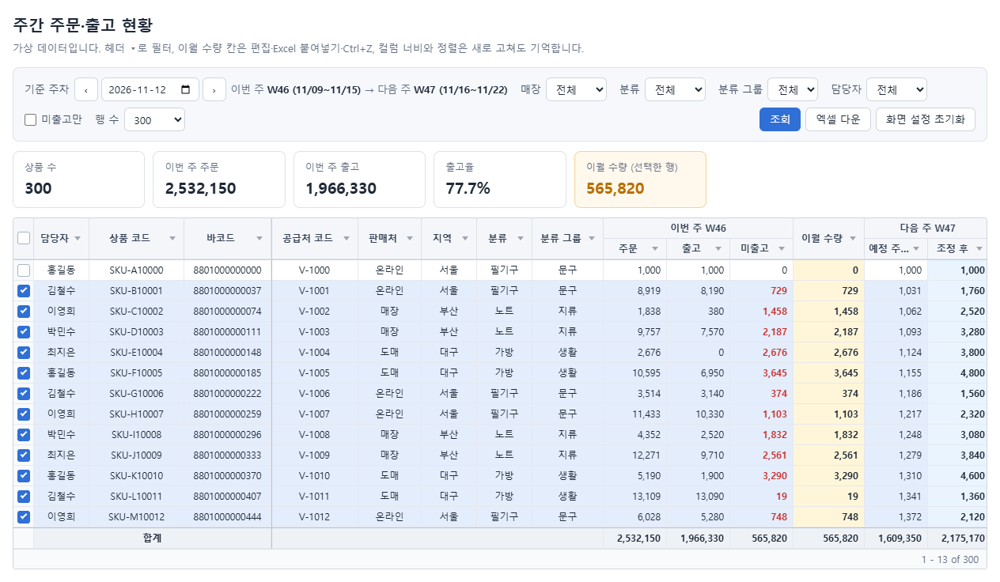
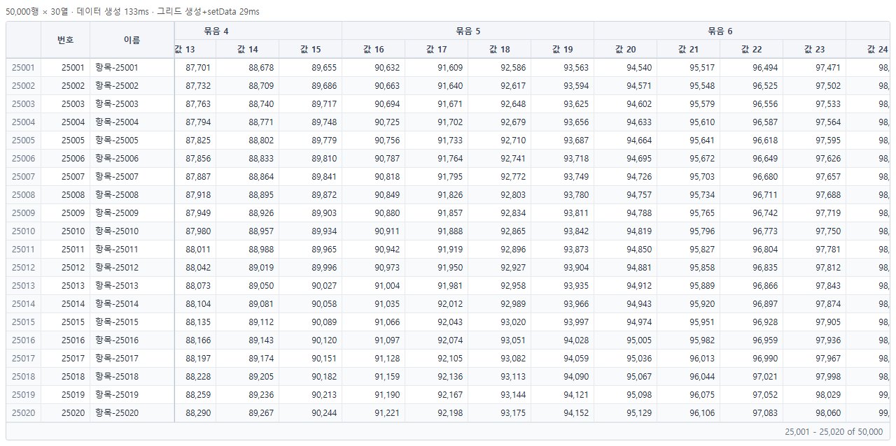
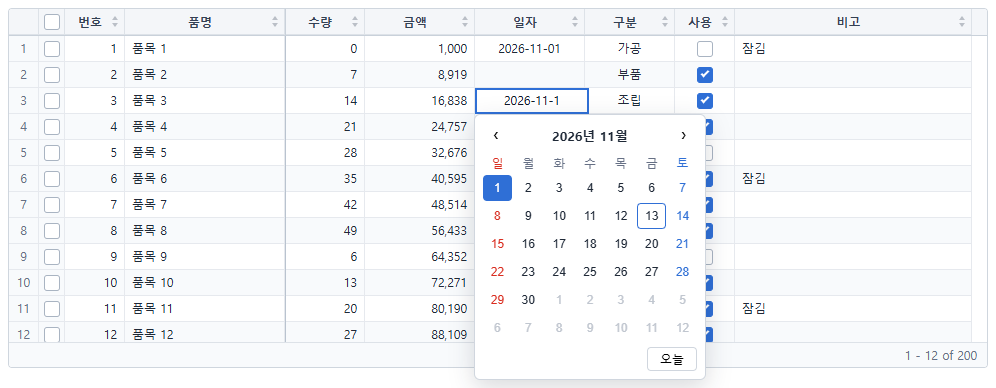
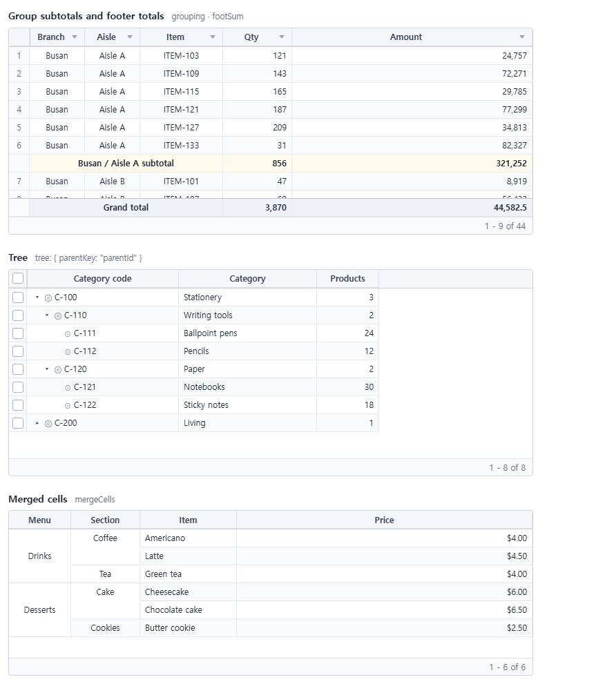
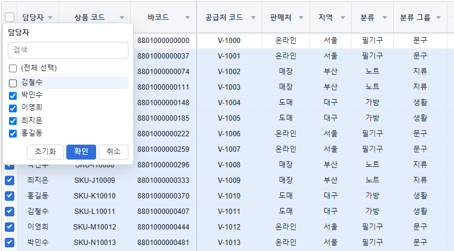

# pyogrid

**[Website](https://herbcookey.github.io/pyogrid/)** · **[Live demos](https://herbcookey.github.io/pyogrid/demo/)** · [npm](https://www.npmjs.com/package/pyogrid) · [Changelog](https://github.com/herbcookey/pyogrid/blob/main/CHANGELOG.md) · [한국어](https://github.com/herbcookey/pyogrid/blob/main/README.ko.md)

A fast, dependency-free data grid in plain JavaScript. It renders tens of thousands of rows with virtual scrolling and handles spreadsheet-style editing: type straight into a cell (IME input such as Korean included), paste from Excel, undo, filter by header values, show footer totals, group subtotals, trees, and export to xlsx.

- No dependencies. xlsx export uses [SheetJS](https://sheetjs.com/) if it is loaded.
- Use it from a single `<script>` tag (global `PyoGrid`) or as an ES module.
- Works with any framework, or none.

> Version 0.9.0 · Chrome, Edge, Firefox, and Safari. See [Browser support](#browser-support).





Top: multi-level headers, frozen columns, row selection, a footer totals row, and the selection summary. Bottom: 50,000 rows × 30 columns scrolled to row 25,001 (virtual scrolling).

## Contents

- [Features](#features)
- [Installation](#installation)
- [Quick start](#quick-start)
- [Using with React, Vue, and Angular](#using-with-react-vue-and-angular)
- [TypeScript](#typescript)
- [Core concepts](#core-concepts)
- [Grid options](#grid-options)
- [Column options](#column-options)
- [Formatters](#formatters)
- [Cell editors](#cell-editors)
- [Keyboard](#keyboard)
- [Accessibility](#accessibility)
- [Methods](#methods)
- [Events](#events)
- [Footer totals and group subtotals](#footer-totals-and-group-subtotals)
- [Tree](#tree)
- [Header filters](#header-filters)
- [Merged cells](#merged-cells)
- [Copy, paste, and undo](#copy-paste-and-undo)
  - [Undoing row changes](#undoing-row-changes)
- [Server-side paging and sorting](#server-side-paging-and-sorting)
- [Excel export](#excel-export)
- [Remembering column widths and sort](#remembering-column-widths-and-sort)
- [Reordering columns](#reordering-columns)
- [Collecting changes for saving](#collecting-changes-for-saving)
- [Global extensions](#global-extensions)
- [Theming](#theming)
- [Localization](#localization)
- [Demos](#demos)
- [Browser support](#browser-support)
- [Stability](#stability)
- [Development](#development)
- [License](#license)

---

## Features

- **Virtual scrolling.** Only visible rows and columns are in the DOM. 50,000 rows × 30 columns is created and filled in 20–50 ms.
- **Frozen columns and multi-level headers.** Header, frozen columns, and footer stick in place with `position: sticky`, so they never lag behind the scroll.
- **Type to edit.** Select a cell and start typing; the first keystroke goes into the cell. IME composition (Korean, Japanese, Chinese) is never cut off, and Enter commits in one press.
- **Six built-in editors:** text, number, money, date (with a calendar), select, and checkbox. You can register your own.
- **Excel-style clipboard.** Copy and paste ranges as tab-separated text, with fill and repeat rules like Excel. Pasted values go through the same validation as typed ones.
- **Undo and redo** for edits, deletes, pastes, and cuts.
- **Change tracking.** Modified, added, and deleted rows are collected for you, and a row stops counting as modified once its values are back to the originals.
- **Header value filters** like Excel's AutoFilter, with search across all values, and optional conditions (contains, greater than, date range).
- **Footer totals, group subtotals, trees, and merged cells.**
- **Selection summary** (count, sum, average) for the selected cells.
- **Server-side paging and sorting.**
- **xlsx export** of what is on screen, with merged headers and real number cells.
- **Remembers column widths, order, and sort** per page in `localStorage`.
- **Reorder columns** by dragging headers or with Alt+Shift+←/→ (optional). Column definitions and footer totals stay as you passed them.
- **Themeable** with CSS custom properties. TypeScript declarations included, with typed rows and events ([TypeScript](#typescript)).
- **Localizable.** English by default, Korean built in, and every built-in string can be replaced.

## Installation

```bash
npm install pyogrid
```

```js
import { PyoGrid } from "pyogrid";
import "pyogrid/css"; // with a bundler such as Vite or webpack
```

Or load it from a CDN without a build step:

```html
<link rel="stylesheet" href="https://cdn.jsdelivr.net/npm/pyogrid@0.9/dist/pyogrid.min.css">
<script src="https://cdn.jsdelivr.net/npm/pyogrid@0.9/dist/pyogrid.min.js"></script>
```

The same files are on unpkg (`https://unpkg.com/pyogrid@0.9/dist/...`). Keep the version in the URL (`@0.9`, or an exact one like `@0.9.0`) on production pages: without it you get whatever the latest release is, including breaking changes.

| File | Use |
|---|---|
| `dist/pyogrid.js` / `pyogrid.min.js` | `<script>` tag (global `PyoGrid`) |
| `dist/pyogrid.esm.js` | ES module |
| `dist/pyogrid.css` / `pyogrid.min.css` | Theme |
| `dist/types/` | TypeScript declarations (`.d.ts`) |

For Excel export, load SheetJS before the grid:

```html
<script src="https://cdn.sheetjs.com/xlsx-0.20.3/package/dist/xlsx.full.min.js"></script>
```

To build from source, see [Development](#development).

## Quick start

```html
<link rel="stylesheet" href="https://cdn.jsdelivr.net/npm/pyogrid@0.9/dist/pyogrid.min.css">
<script src="https://cdn.jsdelivr.net/npm/pyogrid@0.9/dist/pyogrid.min.js"></script>

<div id="grid" style="height: 400px"></div>

<script>
  var grid = new PyoGrid(document.getElementById("grid"), {
    rowSelector: true,         // row selection checkboxes on the left
    frozenColumns: 2,          // freeze the first two columns
    sortable: true,            // click a header to sort
    headerAlign: "center",
    columns: [
      { key: "SKU", label: "SKU", width: 120, align: "center" },
      { key: "NAME", label: "Product", width: "*" },
      { label: "This week", columns: [                     // grouped header
        { key: "QTY", label: "Qty", width: 80, align: "right", formatter: "money",
          editor: { type: "number" } },
        { key: "AMT", label: "Amount", width: 100, align: "right", formatter: "money" }
      ] }
    ],
    footSum: [[
      { label: "Total", colspan: 2, align: "center" },
      { key: "QTY", collector: "sum", formatter: "money", align: "right" },
      { key: "AMT", collector: "sum", formatter: "money", align: "right" }
    ]]
  });

  grid.setData([
    { SKU: "SKU-A1001", NAME: "Ballpoint pen 0.5mm", QTY: 12000, AMT: 3500000 },
    { SKU: "SKU-A1002", NAME: "Spiral notebook", QTY: 8000, AMT: 1200000 }
  ]);

  grid.on("change", function (e) {
    console.log(e.rowIndex, e.key, e.oldValue, "→", e.value);
  });
</script>
```

As an ES module:

```js
import { PyoGrid } from "pyogrid";                     // installed from npm
// import { PyoGrid } from "./dist/pyogrid.esm.js";  // a local build
const grid = new PyoGrid("#grid", { columns: [...] });
```

Give the target element a height. The grid fills it and lays itself out again whenever its size changes (window resize, parent layout).

## Using with React, Vue, and Angular

PyoGrid works with the DOM directly, so it is used the same way everywhere:

1. Render an empty `div` with a height.
2. After it is mounted, create the grid with `new PyoGrid(div, options)`.
3. When it is unmounted, call `grid.destroy()`.

Importing the package does not touch `window` or `document`, so it is safe to import during server-side rendering (Next.js, Nuxt, Angular SSR). Only create the grid after mount.

**React**

```jsx
import { useEffect, useRef } from "react";
import { PyoGrid } from "pyogrid";
import "pyogrid/css";

export function Grid({ columns, rows }) {
  const el = useRef(null);
  const grid = useRef(null);
  const style = { height: 400 };

  useEffect(() => {
    grid.current = new PyoGrid(el.current, { columns });
    return () => grid.current.destroy(); // also cleans up StrictMode's double mount
  }, []);

  useEffect(() => {
    grid.current.setData(rows);
  }, [rows]);

  return <div ref={el} style={style} />;
}
```

**Vue 3**

```vue
<script setup>
import { onMounted, onBeforeUnmount, ref, toRaw, watch } from "vue";
import { PyoGrid } from "pyogrid";
import "pyogrid/css";

const props = defineProps(["columns", "rows"]);
const el = ref(null);
let grid = null; // keep it out of ref()

onMounted(() => {
  grid = new PyoGrid(el.value, { columns: props.columns });
  grid.setData(toRaw(props.rows));
});
watch(() => props.rows, (rows) => grid.setData(toRaw(rows)));
onBeforeUnmount(() => grid.destroy());
</script>

<template>
  <div ref="el" style="height: 400px" />
</template>
```

**Angular**

```ts
import { AfterViewInit, Component, ElementRef, Input, NgZone, OnDestroy, ViewChild } from "@angular/core";
import { PyoGrid } from "pyogrid";

@Component({
  selector: "app-grid",
  template: `<div #host style="height: 400px"></div>`,
})
export class GridComponent implements AfterViewInit, OnDestroy {
  @ViewChild("host") host!: ElementRef<HTMLDivElement>;
  @Input() columns: any[] = [];
  @Input() rows: any[] = [];
  private grid?: PyoGrid;

  constructor(private zone: NgZone) {}

  ngAfterViewInit() {
    // Create it outside Angular so scrolling and typing don't trigger change detection
    this.zone.runOutsideAngular(() => {
      this.grid = new PyoGrid(this.host.nativeElement, { columns: this.columns });
      this.grid.setData(this.rows);
    });
    // Re-enter Angular only for handlers that update component state
    this.grid!.on("change", (e) => this.zone.run(() => { /* ... */ }));
  }

  ngOnDestroy() {
    this.grid?.destroy();
  }
}
```

In Angular, add `node_modules/pyogrid/dist/pyogrid.css` to `styles` in `angular.json`.

**Things to keep in mind**

- **Let the grid own the data.** Editing a cell writes straight into the row object you passed in ([Core concepts](#core-concepts)). Don't mirror the same rows in React state or Vue reactive data; when saving, read the changes with `getModifiedRows()` and `getDeletedRows()`.
- **In Vue, pass plain objects with `toRaw`.** A reactive proxy makes every edit go through Vue's reactivity and slows the grid down. Don't put the grid instance in `ref()` either.
- **Cells are strings.** Cell content is the text your `formatter` returns, or HTML with `html: true`. Rendering React or Vue components inside cells is not supported.
- **`setData` resets selection and undo history.** If the parent hands down a new `rows` array after every edit, the editing state is lost. Change `rows` only when you load new data.

## TypeScript

Type declarations come with the package (`dist/types`). Give the grid your row type, and rows are typed in methods, column callbacks, and event handlers. Without a row type, rows are `any` as before.

```ts
import { PyoGrid, type ColumnDef } from "pyogrid";

interface Order {
  SKU: string;
  NAME: string;
  QTY: number;
  LOCKED?: "Y" | "N";
}

const columns: ColumnDef<Order>[] = [
  { key: "SKU", label: "SKU", width: 120 },
  { key: "NAME", label: "Product", cellClass: (c) => (c.row.QTY < 0 ? "minus" : "") }, // c.row is an Order
  { key: "QTY", label: "Qty", formatter: "money",
    editor: { type: "number", disabled: (c) => c.row.LOCKED === "Y" } },
];

const grid = new PyoGrid<Order>("#grid", { columns });
grid.setData([{ SKU: "SKU-A1001", NAME: "Ballpoint pen", QTY: 12000 }]); // must be Order[]

// The handler's argument is typed from the event name
grid.on("change", (e) => console.log(e.row.SKU, e.key, e.oldValue, "→", e.value));
grid.on("beforeedit", (e) => e.row.LOCKED !== "Y");

const changed: Order[] = grid.getModifiedRows();
```

- `key` is a `string`, because path keys like `"a.b"` are allowed.
- `getRow()`, `getViewRows()`, `click`, and `dblclick` can give you a group subtotal row, so their row type is `ViewRow<Order>` (`Order | GroupingRow<Order>`).
- Event arguments are listed in `GridEvents<Row>`, for example `GridEvents<Order>["change"]`. `on` and `off` still accept names that aren't in it, with an untyped argument.
- Other type exports: `GridOptions`, `ColumnEditor`, `CellContext`, `GridCellInfo`, `GridClickEvent`, `GroupingRow`, `AppliedChange`, `RangeInfo`, `SortItem`, `SortCompare`, and `PageInfo`.

## Core concepts

**Rows are not copied.** The grid uses the objects you pass to `setData(rows)`, and edits change those objects. State the grid keeps per row lives on the row object too:

| Property (rename with option) | Meaning |
|---|---|
| `__selected__` (`selectedKey`) | Row is selected. Set it in your data to start with the row selected |
| `__modified__` (`modifiedKey`) | A value changed, or the row was added with `addRow` |
| `__added__` (`addedKey`) | Row was added with `addRow` and not saved yet. It stays visible under header filters and isn't recorded when deleted. Cleared by `acceptChanges()` / `clearModified()` |
| `__deleted__` (`deletedKey`) | Row was removed with `deleteRows` |
| `__disable_selection__` (`disableSelectionKey`) | If true, the row can't be selected |
| `collapse` (`tree.collapseKey`) | Tree node is collapsed |

**`rowIndex` is the view index.** It is the position on screen after sorting, filtering, grouping, and tree expansion, and a group subtotal row counts as one row. Sorting changes it, so hold on to the row object if you need a stable reference.

**`colIndex` counts leaf columns.** Header groups are not counted, and neither are the line-number and row-selector columns.

**Three ways to get rows**

| Method | Returns |
|---|---|
| `getRows()` | Data rows after filtering and sorting. No subtotal rows; trees include collapsed children |
| `getViewRows()` | Exactly the rows on screen (subtotal rows included, trees only expanded rows) |
| `getAllRows()` | Everything from `setData` and `addRow`, including rows hidden by filters, excluding deleted rows |

## Grid options

`new PyoGrid(target, options)`. `target` is an element or a CSS selector.

### Layout

| Option | Default | Description |
|---|---|---|
| `columns` | `[]` | [Column definitions](#column-options) |
| `frozenColumns` | `0` | Number of leaf columns to freeze on the left |
| `rowHeight` | `26` | Body row height (px) |
| `headerRowHeight` | `26` | Height of one header row (px) |
| `height` | `null` | A number sets the height in px; `null` fills the target element |
| `lineNumber` | `false` | Line-number column on the left |
| `lineNumberWidth` | `30` | |
| `rowSelector` | `false` | Row selection checkbox column on the left |
| `rowSelectorWidth` | `26` | |
| `headerSelector` | `true` | "Select all" checkbox in the row selector header |
| `headerAlign` | `null` | Default header alignment: `"left"`, `"center"`, or `"right"` |
| `align` | `null` | Default body alignment |
| `rowClass` | `null` | Row class: a string or `function (row, rowIndex)` |
| `defaultColumnWidth` | `100` | Width of columns without `width` |
| `minColumnWidth` | `10` | Minimum width when resizing |
| `resizable` | `true` | Drag header edges to resize columns |
| `columnReorder` | `false` | Drag headers, or press Alt+Shift+←/→, to reorder columns. See [Reordering columns](#reordering-columns). `moveColumn` and `setColumnOrder` work either way |
| `emptyText` | `undefined` | Message when there are no rows. Leave it out to use the locale's message, or pass `null` to show nothing |
| `locale` | `"en"` | Language of built-in text: `"en"`, `"ko"`, or a name registered on `PyoGrid.locales`. See [Localization](#localization) |
| `messages` | `null` | Replace individual built-in strings. See [Localization](#localization) |
| `overscanRows` / `overscanColumns` | `6` / `2` | Extra rows and columns rendered outside the visible area |

### Selection and sorting

| Option | Default | Description |
|---|---|---|
| `multipleSelect` | `true` | If false, only one row can be selected |
| `cellSelect` | `true` | Select cell ranges by clicking and dragging |
| `selectionSummary` | `true` | When two or more cells are selected, show count, sum, and average in the bottom bar. Only numbers, or numeric text in numeric columns (money formatter, number or money editor, or column `numeric: true`), are added up, so codes like barcodes and part numbers are left out |
| `sortable` | `false` | Sort by clicking headers (column `sortable` takes precedence) |
| `multiSort` | `false` | Sort by several columns, in the order they were clicked |
| `sortCompare` | `"smart"` | `"smart"`: numeric strings like "1,200" compare as numbers, natural sort for text in the grid's `locale`, empty values always last. `"plain"`: compare values as they are (converted to strings if their types differ). Or a function `(a, b) => number` |
| `remoteSort` | `false` | If true, rows keep their order and only `sortchange` fires (sort on the server) |

### Editing and clipboard

| Option | Default | Description |
|---|---|---|
| `editable` | `true` | If false, all editors are off |
| `clipboard` | `true` | Ctrl+C, X, V |
| `undo` | `true` | Ctrl+Z, Ctrl+Y |
| `undoLimit` | `50` | Number of undo steps kept |
| `modifiedKey` | `"__modified__"` | |
| `deletedKey` | `"__deleted__"` | |
| `selectedKey` | `"__selected__"` | |
| `disableSelectionKey` | `"__disable_selection__"` | |
| `markAddedModified` | `true` | Mark rows added with `addRow` with `modifiedKey` |
| `addedKey` | `"__added__"` | Property that marks rows added with `addRow` until they are saved |

### Totals, groups, tree, filters, merging

| Option | Default | Description |
|---|---|---|
| `footSum` | `null` | Footer totals rows. See [Footer totals](#footer-totals-and-group-subtotals) |
| `grouping` | `null` | `{ by: [keys...], columns: [cells...] }` for group subtotal rows |
| `tree` | `null` | [Tree](#tree) settings |
| `filter` | `false` | Header filter buttons |
| `filterConditions` | `false` | Show a condition section (contains, greater than, between, ...) in the header filter popup. Only shows or hides the section: `setFilterCondition` works either way. See [Header filters](#header-filters) |
| `mergeCells` | `false` | `true` (all columns) or an array of keys. Merges equal values vertically |

### Bottom bar

| Option | Default | Description |
|---|---|---|
| `pageBar` | `true` | Show the bottom bar (selection summary, page navigation, status text) |
| `pageHeight` | `25` | |
| `statusDisplay` | `true` | Status text on the right, such as `"1 - 15 of 300"` |
| `statusFormat` | `null` | Function `(d) => string` returning the status HTML. `d = {fromRowIndex, toRowIndex, dataRowCount, totalElements}` (all formatted with thousands separators; `totalElements` is false without page info) |
| `pageNavigationCount` | `5` | Number of page buttons |
| `pageIcons` | `{first:null, prev:"«", next:"»", last:null}` | HTML for the navigation buttons; `null` hides that button |

### Persistence and export

| Option | Default | Description |
|---|---|---|
| `stateKey` | `null` | If set, column widths, order, and sort are remembered in the browser |
| `sheetName` | `null` | Worksheet name for Excel export |

## Column options

```js
{
  key: "QTY",            // row property; paths like "a.b", "a['key with spaces']", "list[0].name" work too
  label: "Qty",          // header text (inserted as text; set html: true for HTML)
  width: 80,             // number, "120", "50px", "*", or "30%"
  align: "right",        // body alignment
  headerAlign: "center", // header alignment for this column
  formatter: "money",    // name or function
  html: false,           // true: insert label and formatter output as HTML
  cellClass: function (c) { return c.value < 0 ? "minus" : ""; },
  headerClass: "my-head",
  editor: { type: "number" },
  sortable: true,        // false: never sort; true: sortable even if the grid's sortable is off
  filter: false,         // false: no header filter; true: filter only this column
  multiLine: false,      // true: wrap text in the cell
  resizable: true,
  hidden: false,
  treeControl: false,    // column that shows the tree expand button
  columns: [...]         // child columns make this a header group
}
```

| Property | Description |
|---|---|
| `key` | Row property to read and write. Without it the cell is empty (useful for formatter-only cells) |
| `label` | Header text, inserted as text. With `html: true` it is inserted as HTML |
| `width` | Numbers, `"120"`, and `"50px"` are pixels; `"*"` shares the remaining width; `"30%"` is relative to the grid width. Defaults to `defaultColumnWidth` |
| `align`, `headerAlign` | `"left"`, `"center"`, or `"right"` |
| `formatter` | See [Formatters](#formatters) |
| `html` | If true, `label` and the formatter's output are inserted as HTML. Off by default, so a formatter that returns server text can't inject markup or scripts |
| `cellClass` | Cell class: a string or a function (same argument as a formatter) |
| `headerClass` | Header cell class: a string or `function (column)` |
| `editor` | See [Cell editors](#cell-editors) |
| `sortable`, `filter`, `resizable` | See above |
| `reorderable` | `false`: the column (or the whole group) can't be dragged or moved and keeps its place. See [Reordering columns](#reordering-columns) |
| `multiLine` | Allow line breaks in the cell (Alt+Enter while editing) |
| `numeric` | Treat the column as numeric for the selection summary. By default, columns with the money formatter or a number or money editor are numeric |
| `filterType` | `"text"`, `"number"`, or `"date"`: which conditions the filter popup offers. By default a date editor means `"date"`, a numeric column (see `numeric`) means `"number"`, and anything else `"text"` |
| `filterConditions` | `false` hides the condition section for this column even when the grid's `filterConditions` is on |
| `hidden` | If true, the column is not rendered |
| `columns` | Header group, nested to any depth. A group that spans the frozen edge shows its title on both sides |

## Formatters

A formatter's return value is inserted **as text**, so a barcode or a server string that happens to contain `<` is shown as typed and can't inject markup. To return HTML, set `html: true` on the column, and wrap values that come from users or servers with `PyoGrid.escapeHtml`.

```js
{
  key: "STATUS",
  html: true,              // this formatter returns HTML
  formatter: function (c) {
    // c and this are the same object:
    // c.value, c.row (= c.item), c.key, c.rowIndex (= c.dindex), c.column, c.grid
    var color = c.value === "Done" ? "green" : "gray";
    return '<span style="color:' + color + '">' + PyoGrid.escapeHtml(c.value) + "</span>";
  }
}
```

The only built-in formatter is `"money"`: it strips non-numeric characters, adds thousands separators, and truncates to two decimal places. Floating-point noise in numbers is removed first, so `0.1 + 0.7` shows as `0.8`, not `0.79`. To register your own, see [Global extensions](#global-extensions).

## Cell editors

Give a column an `editor` to make it editable.



```js
editor: {
  type: "text",                      // see the table below
  config: { ... },                   // per-type settings
  disabled: function (c) {           // true: this cell can't be edited (a plain value works too)
    return c.row.LOCKED === "Y";
  },
  attributes: { maxlength: 30 }      // attributes set on the input
}
```

| type | Stored value | config |
|---|---|---|
| `text` | The text as typed | |
| `number` | A number (`""` when empty) | `decimal` digits after the point (0 for integers only), `min`, `max` |
| `money` | A number (`""` when empty). Thousands separators appear while typing | `decimal`, `min`, `max` |
| `date` | A `"yyyy-MM-dd"` string, or the format in `valueFormat`. Typing digits inserts the hyphens, and a calendar opens below the cell. The input always shows yyyy-MM-dd | `valueFormat`: stored format such as `"yyyyMMdd"` or `"yyyy.MM.dd"` (tokens `yyyy`, `MM`, `dd`), or a function `(date) => value` |
| `select` | The chosen option's value. Pick with arrow keys, Enter, or a click, or type to search (Korean included) | `options` array, `columnKeys: { optionValue: "value", optionText: "text" }` |
| `checkbox` | `trueValue` / `falseValue` (`true` / `false` if not set). Toggles on click or Space | `trueValue`, `falseValue` |

- Pressing Enter on an invalid number or date shows a red border and keeps editing. If focus leaves the grid, the edit is cancelled.
- A `select` column without a formatter shows the option text instead of the value.
- `checkbox` cells are drawn as checkboxes, ahead of any formatter. A `disabled` checkbox cell shows its value as text.
- Double-clicking a cell with an editor starts editing, and no `dblclick` event is fired.

```js
// select example
{ key: "KIND", label: "Type", editor: { type: "select", config: {
    columnKeys: { optionValue: "CD", optionText: "NM" },
    options: [{ CD: "A", NM: "Machining" }, { CD: "B", NM: "Parts" }]
} } }
```

**Type to edit, IME included:** select a cell and start typing; editing begins in place and the first character is kept. Enter, Tab, and arrow keys pressed during IME composition are handled after the composition ends, so one Enter commits the value.

## Keyboard

Clicking a cell gives the grid keyboard focus (or call `grid.focus()`).

**Not editing**

| Key | Action |
|---|---|
| Arrow keys | Move |
| Shift+Arrow | Extend the range |
| Ctrl+Arrow | Move to the edge |
| Home / End | Start / end of the row |
| Ctrl+Home / Ctrl+End | First / last cell |
| PageUp / PageDown | One page |
| Tab / Shift+Tab | Right / left (wraps to the next row). On the last cell Tab, and on the first cell Shift+Tab, move focus out of the grid |
| Character keys | Start editing with an empty value (the character is entered) |
| F2, Enter, Space | Start editing with the current value (toggles checkboxes, opens selects). Without an editor, Enter moves down |
| Backspace | Clear and start editing |
| Delete | Clear the editable cells in the range (except checkboxes) |
| Ctrl+A | Select all cells |
| Ctrl+C / Ctrl+X / Ctrl+V | Copy / cut / paste |
| Ctrl+Z / Ctrl+Y (Ctrl+Shift+Z) | Undo / redo |
| Alt+Shift+← / → | Move the current cell's column one place left / right (`columnReorder` only). The cell moves with it |

**Editing**

| Key | Action |
|---|---|
| Enter / Shift+Enter | Commit and move down / up |
| Tab / Shift+Tab | Commit and move right / left. On the last (first) cell, commit and move focus out of the grid |
| ↑ / ↓ | Commit and move up / down (moves through options in a select) |
| ← / → | Move the caret in the text |
| Esc | Cancel |
| Alt+Enter | Line break (`multiLine` columns only) |

Clicking another cell or outside the grid commits the current edit.

## Accessibility

The grid marks up its size and the current cell with ARIA attributes, following the ARIA grid pattern. Automated checks (axe) pass; how NVDA and VoiceOver read the grid has not been checked on real devices yet.

- The element with `role="grid"` has `aria-rowcount` and `aria-colcount` for the whole grid, even though only the visible rows and columns are in the DOM. Rows are counted as header rows, then the rows on screen (group subtotal rows included, collapsed tree children not), then footer total rows. Columns are counted as the line-number and row-selector columns, then the leaf columns.
- Each rendered row has `aria-rowindex` and each cell and header cell has `aria-colindex` (and `aria-colspan` / `aria-rowspan` for grouped and multi-row headers), numbered from the start of the grid, not from the first rendered row.
- Keyboard focus stays on the grid's input box (that keeps IME input working), and its `aria-activedescendant` points at the focused cell. While a cell is being edited, or when the focused cell is scrolled out of view and not rendered, the attribute is removed.
- Sortable headers have `aria-sort`, selected rows `aria-selected`, checkboxes `aria-checked` and a name (the column label, or `messages.selectAll` for the select-all box), and the bottom bar's selection summary is a live region.

The demo pages are checked with [axe](https://github.com/dequelabs/axe-core) (WCAG 2.1 A and AA rules) in Chrome, Firefox, and WebKit. Screen reader behavior (NVDA, VoiceOver) has not been checked on real devices yet; the checklist for that is [docs/a11y-manual-check.md](docs/a11y-manual-check.md) (in Korean). In particular, focus stays on the input box, which is not a parent of the cells, so whether a screen reader follows `aria-activedescendant` from cell to cell is not confirmed. The ARIA attributes and DOM structure are not covered by [Stability](#stability).

## Methods

Most methods return the grid, so calls can be chained (`grid.setData(rows).scrollToRow(0)`).

### Data

| Method | Description |
|---|---|
| `setData(rows, page?)` | Replace the data. Clears the cell range, undo history, and deleted-row list, and scrolls to the top. `page` is [server paging](#server-side-paging-and-sorting) info. Filters and sort are kept |
| `getRows()` | Data rows after filtering and sorting (a new array of the original row objects) |
| `getViewRows()` | Rows on screen (subtotal rows included) |
| `getAllRows()` | All rows (including rows hidden by filters) |
| `getRow(rowIndex)` | Row at a view index |
| `rowCount` | Number of rows on screen (read-only property) |
| `addRow(rows, at?, opts?)` | Add a row or an array of rows. `at`: `"last"` (default), `"first"`, or a view index (inserts before that row). `opts.focus: true` moves to the new row. `opts.undoable: true` records it for Ctrl+Z (see [Undoing row changes](#undoing-row-changes)) |
| `removeRows(targets, opts?)` | Take rows out of the list without recording them as deleted. Accepts row objects, view indexes, or an array of either. `opts.undoable: true` records it for Ctrl+Z |
| `deleteRows(targets, opts?)` | Delete rows: they leave the list and are kept in `getDeletedRows()`. Rows added with `addRow` and not saved yet aren't kept, since the server never had them. In a tree, descendants are deleted too. `opts.undoable: true` records it for Ctrl+Z (descendants included, as one step) |
| `getDeletedRows()` | Deleted rows that existed before (send these as deletes) |
| `getAddedRows()` | Rows added with `addRow` since the last save (send these as inserts). They are also in `getModifiedRows()` |
| `getModifiedRows()` | Rows that changed or were added. A row drops out once every cell is back to its original value (for example, after undo) |
| `getChanges()` | What to send when saving: `{added, modified, deleted}`. Each array holds shallow copies of the rows with the grid's marker keys removed (the property names in `selectedKey`, `modifiedKey`, `addedKey`, and `deletedKey`). `modified` leaves out added rows. A value still being edited is not included; call `commitEdit()` first. The row objects themselves are not changed. Because the copies are shallow, nested objects and arrays are shared with the original rows |
| `cleanRow(row)` | A shallow copy of one row with the same marker keys removed. Works for rows that aren't in the grid. A value that isn't an object (`null`, `undefined`, a number, a string) is returned as it is |
| `clearModified(rows?)` | Clear the modified and added flags (all rows if `rows` is omitted). Call after saving. Rows that lose the added flag follow header filters again |
| `clearDeleted()` | Clear the deleted-row list |
| `acceptChanges()` | After saving: clear modified and added flags, the deleted-row list, and undo history |
| `replaceRow(rowIndex, row)` | Replace the row at that position with another object |
| `setValue(rowIndex \| row, key, value)` | Set a cell value. Pass a view index or a row object; a row object also reaches rows hidden by filters and collapsed tree children (their `change` has `rowIndex: -1`). Returns true if it changed, marks the row `__modified__`, and fires `change`. `null`, `undefined`, and `""` count as the same value |
| `setValues([{rowIndex \| row, key, value}], {source?})` | Set many cells and redraw once. Each entry gives `rowIndex` or `row`. Returns the list of cells that actually changed (`rowIndex: -1` for rows not on screen) |

### Row selection

| Method | Description |
|---|---|
| `selectRow(rowIndex, selected?)` | Select or deselect; toggles if `selected` is omitted. Returns the new state |
| `selectRowRange(from, to, selected)` | Set rows `from` through `to` to the same state |
| `selectAll(selected = true, filter?)` | Select or deselect all; only rows where `filter(row, i)` is true |
| `clearSelection()` | Deselect all |
| `getSelectedRows()` | Selected rows (in `getRows()` order) |
| `getSelectedIndexes()` | View indexes of the selected rows |
| `isRowSelected(row)` / `isRowSelectable(row)` | |

### Cell range

| Method | Description |
|---|---|
| `setRange(r0, c0, r1?, c1?)` | Select a range. Out-of-bounds coordinates are clamped |
| `clearRange()` | |
| `getRange()` | `{r0, c0, r1, c1, active: {r, c}}` or null |
| `getActiveCell()` | `{rowIndex, colIndex, row, column, key, value}` or null. In a range this is the end that moved last (where a drag, Shift+click, or Shift+arrow ended), not the cell where the range started. After `setRange(r0, c0, r1, c1)` it is `(r1, c1)` |
| `getRangeCells()` | Cells in the range: `[{rowIndex, colIndex, row, key, value}]` |
| `getSelectionSummary()` | `{count, numCount, sum, avg}` |
| `getRangeText()` | The range as Excel-style text (tabs and newlines), using raw values |

### Sorting, filtering, tree

| Method | Description |
|---|---|
| `setSort([{key, dir}])` | Sort. `dir` is `"asc"` or `"desc"`. An empty array restores the original order |
| `getSort()` | |
| `toggleSort(colIndex)` | Same as clicking the header: none → desc → asc → none |
| `setFilter(key, values \| null)` | Values to show for that column; `null` removes the value list (a condition on the same column stays) |
| `setFilterCondition(key, condition \| null)` | Set a condition on that column (see [Conditions](#conditions)); `null` removes it. Throws `TypeError` for an invalid condition and leaves the filters unchanged |
| `getFilterConditions()` | `{key: condition}`, a copy |
| `clearFilters()` | Removes value lists and conditions |
| `getFilters()` | `{key: [values...]}` (value lists only) |
| `openFilter(colIndex)` | Open the filter popup |
| `isFilterActive()` | True if any value list or condition is set |
| `toggleNode(rowIndex \| row, collapsed?)` | Collapse or expand a tree node |
| `expandAll()` / `collapseAll()` | |
| `getTreeInfo(row)` | `{depth, children, parent}` |

### Editing, clipboard, undo

| Method | Description |
|---|---|
| `startEdit(rowIndex, colIndex, {mode?})` | Start editing. `mode` is `"edit"` (current value, default) or `"type"` (empty) |
| `commitEdit()` | Commit. Returns false if the value is invalid |
| `cancelEdit()` | |
| `isEditing` | Whether a cell is being edited (property) |
| `focus()` | Give the grid keyboard focus |
| `copy()` | Copy the range to the clipboard (returns a Promise and needs clipboard permission; Ctrl+C doesn't) |
| `paste(text)` | Paste text starting at the top-left of the range. Returns `{applied, skipped, rows}` |
| `cut()` | Return the range as text and clear it. Only cells that Delete would clear are emptied: cells with an editor that isn't disabled, except checkboxes. The text still includes every cell in the range |
| `undo()` / `redo()` | Return false when there is nothing to undo or redo |
| `canUndo` / `canRedo` | (properties) |
| `clearHistory()` | |

### Columns and layout

| Method | Description |
|---|---|
| `setColumns(columns)` | Replace all columns (resets user-resized widths and restores widths saved under `stateKey`). Filters and sorts on keys that no longer exist, or are no longer filterable or sortable, are removed and `filterchange` / `sortchange` fire. The same applies to `addColumn`, `removeColumn`, and `updateColumn` |
| `getColumns()` | The column definitions array the grid is using, not a copy, in definition order. Moving columns doesn't change it or the definitions in it; the screen order is `getColumnOrder()`. Changing the array doesn't redraw the grid; to apply changes, pass the columns to `setColumns` (which also resets the column order) |
| `addColumn(column, index?)` | Add a top-level column, at the end if `index` is omitted |
| `removeColumn(index?)` | Remove a column, the last one if `index` is omitted |
| `updateColumn(column, index)` | |
| `setColumnWidth(colIndex, px)` | |
| `getColumnWidths()` | Widths of the leaf columns |
| `moveColumn(column, toIndex)` | Move a column within its parent. `column` is a leaf index, a `key`, or a definition object from `getColumns()` (a group moves as a whole); `toIndex` is the leaf index the column (a group's first leaf) ends up at. Returns false and changes nothing when the column can't go there or is already there. See [Reordering columns](#reordering-columns) |
| `getColumnOrder()` | Keys of the leaf columns in screen order (columns without a `key` are left out) |
| `setColumnOrder(keys \| null)` | Set the order at once. Columns not in the list keep their definition place; `null` restores the definition order. Returns false for an order that crosses the frozen edge |
| `layout()` | Recalculate size and columns, then redraw |
| `refresh()` | Redraw the visible rows (after changing row objects directly) |
| `refreshRow(rowIndex)` | Redraw one row |
| `scrollToRow(rowIndex, align?)` | `"nearest"` (default) or `"top"` |
| `scrollToCell(rowIndex, colIndex)` | |
| `setHeight(px \| css value \| null)` | |
| `setPage(page)` | Update only the page info |
| `cellContext(r, c)` / `cellText(r, c)` | Cell info / text as displayed |

### Export, persistence, misc

| Method | Description |
|---|---|
| `exportExcel(fileName, {sheetName?, XLSX?})` | Save as xlsx. Returns false without SheetJS |
| `getExportData()` | The table to export (`{rows, merges, widths, headerRows}`) |
| `resetState()` | Forget saved widths, order, and sort |
| `on(name, fn)` / `off(name, fn?)` | Events |
| `destroy()` | Remove the grid and its listeners |

## Events

```js
grid.on("change", function (e) { ... });   // `this` is the grid
grid.off("change", handler);               // omit handler to remove all listeners for the event
```

| Event | When | Payload |
|---|---|---|
| `click` / `dblclick` | A cell is clicked | `{row, item, rowIndex, dindex, colIndex, column, key, value, event, grid}`. For the line-number and row-selector columns, `special` is set and there is no `colIndex` |
| `selectionchange` | Row selection changes | `{index, row, selected, source, changed: [rows], indexes: [indexes]}`. `source`: `"click"`, `"range"`, `"all"`, `"api"` |
| `rangechange` | The cell range changes | `{range}` |
| `sortchange` | Sort changes | `{sort}` |
| `filterchange` | Filters change | `{filters, conditions, count}`. `conditions` is the same as `getFilterConditions()` |
| `pagechange` | A page button is clicked | `{page, current, info}` (`page` is zero-based) |
| `change` | A cell value changes | `{row, item, rowIndex, dindex, key, value, oldValue, source, batch}`. `rowIndex` is -1 when the row isn't on screen (hidden by a filter, or a collapsed tree child). `source`: `"edit"`, `"clear"`, `"paste"`, `"cut"`, `"undo"`, `"redo"`, `"api"` |
| `batchchange` | Many cells change at once (Delete, paste, and so on) | `{source, changes: [{rowIndex, row, key, value, oldValue}]}` |
| `beforeedit` | Before editing starts | Cell info plus `mode`. **Return false to prevent editing** |
| `editstart` / `editend` | Editing starts / ends | Cell info plus `mode` / `committed` |
| `keydown` | A key is pressed in the grid | `{event, editing}`. **Return false to stop the grid from handling it** |
| `copy` / `paste` | Copy / paste | `{range, text}` / `{applied, skipped, rows}` |
| `undo` / `redo` | | `{source, count}` |
| `rowsadd` / `rowsremove` / `rowsdelete` | Rows are added / removed / deleted | `{rows, source}`. `source` is `"api"` for a method call, `"undo"` or `"redo"` when Ctrl+Z / Ctrl+Y brought rows back or took them out. See [Undoing row changes](#undoing-row-changes) |
| `treetoggle` | A tree node is collapsed or expanded | `{row, collapsed}` |
| `columnresize` | A column is resized | `{index, column, width}` |
| `columnmove` | The column order changes | `{column, from, to, order}`. `column` is the moved definition (a group's for a group), `from` and `to` its (first) leaf index, `order` the same as `getColumnOrder()`. After `setColumnOrder`, `column` is null and `from` and `to` are -1 |
| `scroll` | Scroll | `{top, left}` |
| `datachange` | `setData` | `{rows}` |

**`change` during bulk edits:** Delete, paste, and undo fire `change` for each cell with `batch: true`, then one `batchchange` at the end. If you do heavy work per cell, skip the batched `change` events and handle `batchchange` once.

```js
grid.on("change", function (e) {
  if (e.key !== "QTY") return;
  recalc(e.row);
  if (!e.batch) grid.refreshRow(e.rowIndex);
});
grid.on("batchchange", function () { grid.refresh(); });
```

**Errors in handlers:** if a handler throws, the error is reported (`reportError`, so it shows in the console and reaches `window.onerror`), and the grid carries on. The other handlers still run, and the grid still redraws, records undo, and fires `batchchange`. A handler that throws in `beforeedit` or `keydown` doesn't count as returning false.

## Footer totals and group subtotals

**Footer totals (`footSum`)** sit below the body and scroll horizontally with the columns. Each array is one row.



From the top: group subtotals with a footer totals row, a [tree](#tree), and [merged cells](#merged-cells).

```js
footSum: [[
  { label: "Total", colspan: 3, align: "center" },          // no key: show the label
  { key: "QTY", collector: "sum", formatter: "money", align: "right" },
  { key: "AMT", collector: function () {                    // custom calculation
      return this.list.reduce(function (s, r) { return s + (r.AMT || 0); }, 0);
    }, formatter: "money", align: "right" }
]]
```

| Cell property | Description |
|---|---|
| `label` | Text when there is no `key`, or a function (`this = {key, list, groupBy}`) |
| `key` + `collector` | A calculated value. A name (`"sum"`, `"avg"`, `"count"`, `"min"`, `"max"`) or a function (`this = {key, list}`) |
| `formatter` | Applied to the calculated value (`this.value`) |
| `colspan` | Number of leaf columns to span, starting from the left (line-number and row-selector columns don't count). The columns are counted in definition order; after [reordering](#reordering-columns), a cell whose columns are no longer next to each other is split into pieces, and its text goes in the leftmost piece |
| `align`, `className` | |
| `html` | If true, the label and formatter output are inserted as HTML. By default they are text, which matters for group subtotal labels built from data |

Totals are calculated from the filtered rows (`getRows()`) and update when values change. `sum`, `avg`, `min`, and `max` skip empty cells and text without digits, the same rule as the selection summary, so an empty cell doesn't pull `min` to 0 or lower the average. Sums are rounded to the longest decimal place among the values (`0.1 + 0.2` is `0.3`). `avg` is rounded to two decimal places and is empty when there are no numbers.

**Group subtotals (`grouping`)** sort by the group keys (ascending) and insert a subtotal row after each group. With several keys, inner subtotals come first. Changing a group key value (by editing, paste, `setValue`, or undo) moves the row to its new group right away. Cells are defined the same way as in `footSum`.

```js
grouping: {
  by: ["STORE", "SECTION"],
  columns: [
    { label: function () { return this.groupBy.labels.join(" / ") + " subtotal"; }, colspan: 3 },
    { key: "QTY", collector: "sum", formatter: "money", align: "right" }
  ]
}
```

`this.groupBy` is `{keys: [...], labels: [...]}`. Subtotal rows are objects shaped like `{__isGrouping: true, __groupingList, __groupingBy}` in the view rows. They can't be selected, edited, or pasted into, and they don't get a line number.

## Tree

Shows a flat list linked by parent keys as a tree. A row whose parent value is missing, empty, or `"top"` is a root node. Keys are compared as text, so a parent `id: 1` and a child `pid: "1"` match.

```js
var grid = new PyoGrid("#grid", {
  tree: {
    parentKey: "parentId",    // default "pid"
    selfKey: "id",            // default "id"
    collapseKey: "collapse",  // row property holding the collapsed state
    indentWidth: 14,          // default 10
    arrowWidth: 15,
    iconWidth: 18,
    icons: {                  // HTML works too; an empty string hides the icon
      openedArrow: "▾", collapsedArrow: "▸",
      groupIcon: "⊚", collapsedGroupIcon: "⊚", itemIcon: "⊙"
    }
  },
  columns: [
    { key: "id", label: "Category code", width: 220, treeControl: true },
    { key: "name", label: "Category" }
  ]
});
grid.setData([
  { id: "C-100", parentId: "", name: "Stationery" },
  { id: "C-110", parentId: "C-100", name: "Writing tools" },
  { id: "C-111", parentId: "C-110", name: "Ballpoint pens", collapse: false }
]);
```

Sorting applies among siblings. Header filters are not available in tree mode.

## Header filters

With `filter: true`, each header gets a ▾ button that opens a value list, like Excel's AutoFilter (search, select all, reset / OK / cancel, Enter and Esc).



- The list shows only values from rows that pass the other columns' filters. With many values only the first 2,000 are drawn, but search, select all, and OK apply to every value (pressing OK without changes adds no condition). OK is disabled while nothing is checked, so the filter can't hide every row by accident.
- Select-editor columns list option names, and money columns list formatted numbers. Empty values appear as "(Blank)".
- Filters survive `setData`. When no rows match, the grid shows "No rows match the filter". Both texts can be changed; see [Localization](#localization).
- Rows added with `addRow` stay visible even when they don't match, so a new empty row doesn't vanish the moment it is added. After saving (`acceptChanges()` or `clearModified()`) they follow the filters like any other row.
- In the popup, Enter applies the filter from the search box or the list, and presses the button when a button has focus. Enter and Esc pressed while an IME is composing are left to the IME.
- Popups (this one, the calendar, and the select list) stay attached to their cell when the page, a modal, or any other container scrolls, and when the window is resized. A popup that doesn't fit below opens above.
- Not available in tree mode or with server paging (`setData(rows, page)`).
- From code: `grid.setFilter("MANAGER", ["Alice", "Bob"])`, `grid.clearFilters()`

### Conditions

With `filterConditions: true`, the popup also has a condition section above the value list: pick an operator and type a value. OK applies the value list and the condition together. On one column both must pass, and filters on different columns must all pass. Clear removes both for that column.

```js
grid.setFilterCondition("NAME", { type: "text", op: "contains", value: "seoul" });
grid.setFilterCondition("QTY", { type: "number", op: "ge", value: 100 });
grid.setFilterCondition("QTY", { type: "number", op: "between", from: 10, to: 20 }); // either end can be left out
grid.setFilterCondition("DAY", { type: "date", from: "2026-03-01", to: "2026-03-31" });
grid.setFilterCondition("QTY", null); // remove
```

| `type` | `op` | Value fields | Compares |
|---|---|---|---|
| `"text"` | `contains`, `startsWith`, `equals`, `notEquals` | `value` (string) | The text shown in the filter list (option names for select editors, formatted numbers for money columns), ignoring case. Case is folded with JavaScript's `toLowerCase()`, the same as the popup's search box, not by the grid's `locale`; in Turkish, for example, `"I"` doesn't match `"ı"` |
| `"number"` | `eq`, `ne`, `gt`, `ge`, `lt`, `le` | `value` (number) | Numbers and number text such as `"1,200"` |
| `"number"` | `between` | `from`, `to` (numbers, ends included) | Same |
| `"date"` | `between` (may be omitted) | `from`, `to` (`"yyyy-MM-dd"`, ends included) | The date part as text, see below |

- Empty cells and values that aren't numbers or dates don't pass, except for `notEquals` and `ne`. Those are the exact opposite of `equals` and `eq`, so empty cells pass them, as in Excel.
- Dates are compared as `"yyyy-MM-dd"` text and never turned into `Date` objects, so a time zone can't move a value to another day. Cell values are read with the date editor's `valueFormat` when it is a format string such as `"dd/MM/yyyy"`, then as `2026-03-01`, `2026.3.1`, `2026/3/1`, or `20260301`. A time after the date is ignored. `Date` objects use their local date. `from` and `to` accept the same forms and are stored as `"yyyy-MM-dd"`.
- The `filterConditions` option only shows or hides the section in the popup. `setFilterCondition` works when it is off, the header button shows the filter as on, and the popup's Clear still removes the condition.
- In the popup, number boxes are cleaned up as you type the same way as the number editor, and date boxes the same way as the date editor (typed digits become `yyyy-MM-dd`). There is no calendar. An invalid value marks the box with `aria-invalid` and keeps the popup open.
- The value list is narrowed by other columns' conditions, but not by the condition on its own column.
- Measured in Chrome with 200,000 rows, from `setFilterCondition` to the next frame: text contains about 20 ms, number comparisons 17 ms, number text such as `"1,234"` 42 ms, date range 41 ms.

## Merged cells

```js
mergeCells: ["KIND", "SUB"]   // or true for all columns
```

A cell merges with the one above when the text is the same and the merge columns to its left continue as well. Columns with an editor and subtotal rows are never merged. To work with virtual scrolling, cells are not actually spanned: the horizontal lines inside a block are hidden and the text shows only on the middle row of the block's visible part. If a block is taller than the viewport, the text follows as you scroll.

## Copy, paste, and undo

- **Copy (Ctrl+C):** copies the range as Excel-style text (tabs and newlines). Values are raw, not formatted, so pasting them back gives the same values.
- **Paste (Ctrl+V):** pastes cells copied from Excel, starting at the top-left of the range.
  - Understands quoted cells (newlines and tabs inside a cell), numbers with thousands separators like "1,234", and dates like `2026.11.12`.
  - Pasting one cell into a larger range fills it. If the range is a whole multiple of the copied block, the block repeats.
  - Cells without an editor or with a disabled one, values that don't fit (text in a number cell, an unknown select option), and cells outside the grid are skipped. The bottom bar shows how many cells were pasted and skipped.
  - Pasted values are validated like typed ones: `min`, `max`, and `decimal` for number and money, date checks, `editor.attributes.maxlength` (longer text is cut), and `parse` for custom editors.
  - A value that means the same as the current one (0 and "0" in a text cell, "1,200" and 1200 in a money cell) is left alone, so the row isn't marked modified. The same goes for pressing Enter without changing a value while editing.
  - Select cells accept the option value or its name. Checkbox cells accept `trueValue`/`falseValue`, Y/N, true/false, and 1/0.
- **Cut (Ctrl+X):** copies, then clears.
- **Undo (Ctrl+Z):** undoes one action at a time: a cell edit, a Delete, a paste (as a whole), or a cut. Redo is Ctrl+Y. Undo finds the right row even after the order changes through sorting. `setValue` calls from code are not recorded, and neither are `addRow`, `deleteRows`, and `removeRows` unless you pass `undoable: true` (see below).
- `undoLimit` counts steps: a paste of many cells, or one `deleteRows` call with many rows, is one step.
- If a row was deleted without recording, undoing an earlier edit of that row only writes the value back to the row object; the row stays deleted.

### Undoing row changes

```js
grid.addRow({ SKU: "", QTY: 0 }, "last", { focus: true, undoable: true });
grid.deleteRows(grid.getSelectedRows(), { undoable: true });
```

With `undoable: true`, one call is one step for Ctrl+Z and Ctrl+Y, mixed in order with cell edits.

**Buttons take the focus.** Ctrl+Z only reaches the grid while it has keyboard focus, and clicking a toolbar button moves the focus to the button. Call `grid.focus()` at the end of the button's handler (`addRow` with `focus: true` already does).

```js
document.getElementById("btnDelete").onclick = function () {
  grid.deleteRows(grid.getSelectedRows(), { undoable: true });
  grid.focus(); // so that Ctrl+Z reaches the grid
};
```

- **Undoing a delete** puts the rows back where they were, with their marker keys: they leave `getDeletedRows()`, and rows that had been added stay added rows. Tree descendants deleted with them come back under the same parent. Under a sort they go to their sorted place, and rows hidden by a filter stay hidden. The range moves to the first row that came back, and the grid scrolls to it.
- **Undoing an add** takes the rows out; redo puts them back at the same place.
- **Events.** Rows coming back fire `rowsadd`, rows taken out fire `rowsremove` (or `rowsdelete` when redoing a delete), all with `source: "undo"` or `"redo"`. **Check `source` in your handlers:** after undoing a delete, `rowsadd` fires for rows that already exist on the server. Selected rows that come back or leave also fire `selectionchange` with the same `source`.
- **Rows changed by your code in between.** A row that isn't in the expected state is skipped, in both directions: if you removed an added row yourself, undo and redo leave it out; if you put a deleted row back yourself, undo doesn't add it twice. When the row a group was next to is gone, the rows go back to their old index. A step with no row left to process is dropped, and Ctrl+Z (or Ctrl+Y) goes on to the next step; when none is left, the bottom bar says there is nothing to undo.
- **After saving.** The simplest is `acceptChanges()`, which clears undo history, so nothing saved can be undone. If you only call `clearModified()` or `clearDeleted()`, history stays. Undoing then keeps `getChanges()` correct: undoing the add of a saved row turns it into a deleted row, and undoing an already-processed delete brings the row back as an added row. Redo returns to the state right after saving.
- `setData` also clears history. `replaceRow` isn't recorded.

## Server-side paging and sorting

```js
var grid = new PyoGrid("#grid", {
  sortable: true,
  remoteSort: true,                         // the server sorts
  pageIcons: { first: "|«", prev: "«", next: "»", last: "»|" },
  columns: [...]
});

function load(pageNo, sort) {
  fetch("/api/list?page=" + pageNo + "&sort=" + encodeURIComponent(JSON.stringify(sort || [])))
    .then(function (r) { return r.json(); })
    .then(function (res) {
      grid.setData(res.list, {
        currentPage: pageNo,                // zero-based
        pageSize: 50,
        totalElements: res.total,
        totalPages: Math.ceil(res.total / 50)
      });
    });
}
grid.on("pagechange", function (e) { load(e.page, grid.getSort()); });
grid.on("sortchange", function (e) { load(0, e.sort); });
load(0);
```

With page info, the bottom bar shows page numbers and the status text gains `Total 1,234`.

## Excel export

```js
grid.exportExcel("weekly-shipments-W46.xlsx");   // ".xls" is saved as .xlsx
grid.exportExcel("list", { sheetName: "List" });
```

- Requires SheetJS (`window.XLSX`). As a module, pass it as `{ XLSX }`. Without it, the grid logs a warning and returns false.
- Exports what is on screen: filters and sort, column order, subtotal rows, footer totals, and column widths.
- Multi-level headers and footer `colspan` become merged cells.
- Cell text is the formatter output with HTML stripped. Numbers become number cells:
  - Numbers with thousands separators like "1,234" → a number with the `#,##0` format
  - Number values, and number-like text in money-formatter columns, right-aligned columns, or total cells → numbers
  - Codes with leading zeros (`0012`) stay text
- The line-number and row-selector columns are left out. Trees export only expanded rows.

## Remembering column widths and sort

```js
new PyoGrid("#grid", { stateKey: "weekly-grid", columns: [...] });
```

When the user resizes a column, sorts by a header, or reorders columns, the grid saves it to `localStorage` under `"pyogrid:" + page path + ":" + stateKey` and restores it when the grid is created and on `setColumns`. Columns are matched by `key`, so saved widths survive changes to the column set (for example, week-by-week headers). A saved order that would cross the frozen edge is ignored. Values saved by older versions, without an order, still load. `grid.resetState()` clears it.

## Reordering columns

```js
new PyoGrid("#grid", { columnReorder: true, columns: [...] });

grid.moveColumn("QTY", 0);                 // by key, leaf index, or definition object
grid.setColumnOrder(["QTY", "NAME"]);      // others keep their definition place
grid.getColumnOrder();                     // ["QTY", "NAME", ...]
grid.setColumnOrder(null);                 // back to the definition order
```

With `columnReorder: true`, drag a header (a group header moves the whole group). Dragging starts after the pointer moves more than 5 px, so a click still sorts. While dragging, a copy of the header follows the pointer and a line shows where it will go; near the left or right edge of the scrolling area the grid scrolls sideways. Esc cancels. Touch dragging isn't supported. Alt+Shift+← / → moves the current cell's column by one place; return `false` from a `keydown` handler to stop it.

- **Definitions don't change.** The order is kept apart from the definitions, like widths and sort. `getColumns()`, group definitions, `footSum`, and `grouping.columns` stay as you passed them.
- **Where a column can go.** A leaf moves only within its group, and a group within its parent. Columns can't cross the frozen edge, and a group that spans it can't move. Columns without a `key` and columns with `reorderable: false` keep their place; the others move around them.
- **What follows the column.** Sort, filters, conditions, user-resized widths, and the current cell (a range shrinks to the current cell). Merged cells and footer and subtotal pieces are worked out again for the new order. Excel export uses the screen order.
- **Column changes.** `setColumns` resets the order (and restores a saved one with `stateKey`). `addColumn`, `removeColumn`, and `updateColumn` keep it; a new column appears at its definition place. Hidden columns keep their place in the order and come back there when shown.
- Moving columns isn't recorded for undo. Each move fires `columnmove`.

## Collecting changes for saving

A typical save button:

```js
function save() {
  // A value still being typed into a cell isn't in the row yet. Commit it first.
  if (!grid.commitEdit()) {
    // The value is invalid (for example, text in a number cell): the cell stays in edit mode with a red border
    grid.focus();
    return;
  }
  // added: rows added with addRow (inserts), modified: changed rows (updates), deleted: removed rows (deletes)
  var changes = grid.getChanges();              // copies without __selected__, __modified__, __added__, __deleted__
  return fetch("/api/save", {
    method: "POST",
    headers: { "Content-Type": "application/json" },
    body: JSON.stringify(changes)
  }).then(function (res) {
    if (res.ok) grid.acceptChanges();           // saved values become the new baseline
  });
}

document.getElementById("btnAdd").onclick = function () {
  grid.addRow({ SKU: "", QTY: 0 }, "last", { focus: true });
};
document.getElementById("btnDelete").onclick = function () {
  grid.deleteRows(grid.getSelectedRows());
};
```

Call `commitEdit()` before `getChanges()`. While a cell is being edited, the typed value is only in the editor, not in the row, so `getChanges()` (and `getModifiedRows()`) don't include it. `commitEdit()` saves it to the row and returns `true`, or returns `false` and keeps editing if the value is invalid; don't save in that case.

The rows in `getChanges()` are shallow copies: top-level properties are copied, but nested objects and arrays (`row.meta`, `row.items`) are the same objects as in the grid. Don't change those in the copies if you don't want the grid's rows to change. `getAddedRows()`, `getModifiedRows()`, and `getDeletedRows()` still return the grid's own row objects, marker keys included. To send one row, use `grid.cleanRow(row)`.

## Global extensions

The `<script>` build attaches these to `PyoGrid`:

```js
// Register a formatter: use it with formatter: "yn"
PyoGrid.formatters.yn = function (c) { return c.value === "Y" ? "Yes" : "No"; };

// Register a collector: collector: "nonZeroCount"
PyoGrid.collectors.nonZeroCount = function () {
  var k = this.key;
  return this.list.filter(function (r) { return Number(r[k]) !== 0; }).length;
};

// Register an input editor: editor: { type: "upper" }
PyoGrid.editors.upper = {
  kind: "input",                 // edit in the grid's input box
  typeToEdit: true,              // start editing by typing in the cell
  clearable: true,               // Delete clears it
  format: function (v) { return v == null ? "" : String(v); },          // text shown when editing starts
  parse: function (s) { return { ok: true, value: s.toUpperCase() }; }, // stored value (ok: false rejects it); paste goes through this too
  sanitize: function (s) { return s.replace(/[^A-Za-z0-9]/g, ""); }    // cleanup while typing (optional, not used for paste)
};
```

| Name | Description |
|---|---|
| `PyoGrid.version` | |
| `PyoGrid.locales` | Built-in text per language. Add a language here; see [Localization](#localization) |
| `PyoGrid.escapeHtml(v)` | Escape HTML |
| `PyoGrid.formatNumber(n, locale?)` | Thousands separators, up to two decimal places, in `locale` (default `"en"`) |
| `PyoGrid.sortRows(rows, sort, compare?, locale?)` | Sort an array with the grid's rules (returns a new array) |
| `PyoGrid.util.getValue(row, key)` / `setValue(row, key, v)` | Read and write path keys |
| `PyoGrid.util.toNumber(v)` | "1,200" → 1200; null if not a number |

The ES module exports the same things by name: `formatters`, `editorTypes`, `userCollectors`, `escapeHtml`, `sortRows`, `parseTSV`, `buildTSV`, `locales`, and more (see `src/index.js`). Exports not named in this README are not covered by [Stability](#stability).

## Theming

The default theme has a light gray header and a blue accent. Override the CSS custom properties on `.pyo`:

```css
#myGrid .pyo {
  --pyo-accent: #0f766e;        /* focus, selection, sort marks */
  --pyo-head-bg: #f0fdfa;
  --pyo-row-odd: #fafafa;
}
/* per-page cell styles go on classes added with cellClass */
#myGrid .minus { color: #c9302c !important; }
```

| Variable | Default | Used for |
|---|---|---|
| `--pyo-border` | `#cfd6de` | Grid border |
| `--pyo-text` | `#1f2937` | Text |
| `--pyo-head-bg` / `--pyo-head-text` | `#f4f6f9` / `#344054` | Header |
| `--pyo-head-line` / `--pyo-head-bottom` | `#dde2e8` / `#c9d1da` | Header lines |
| `--pyo-cell-line` | `#e6e9ee` | Cell lines |
| `--pyo-row-even` / `--pyo-row-odd` | `#fff` / `#f8fafc` | Stripes |
| `--pyo-row-hover` / `--pyo-row-selected` | `#eef4fd` / `#e3edfc` | Row hover and selection |
| `--pyo-range-bg` / `--pyo-active-bg` | `#cfe0fa` / `#eaf2fe` | Cell range and focused cell |
| `--pyo-accent` | `#2f6fd6` | Accent color |
| `--pyo-frozen-line` | `#b9c3cf` | Frozen-column edge and the line above the footer |

Main classes: `.pyo-row` (`.pyo-selected`, `.pyo-group-row`), `.pyo-cell` (`.pyo-in-range`, `.pyo-active`, `.pyo-merged`), `.pyo-hcell`, `.pyo-foot`, `.pyo-page`, `.pyo-popup` (editor and filter popups). Class names and DOM structure can change between releases; see [Stability](#stability).

## Localization

Built-in text (the empty message, header filter popup, calendar, and bottom-bar messages) is English by default. Korean is built in:

```js
new PyoGrid("#grid", { locale: "ko", columns: [...] });
```

Change individual strings with `messages`. Anything you leave out comes from the locale:

```js
new PyoGrid("#grid", {
  messages: {
    empty: "Nothing to show",
    ok: "Apply",
    copied: (count) => count + " copied",
  },
  columns: [...]
});
```

To add a language, register it on `PyoGrid.locales` (or the `locales` export) and use its name. Missing strings fall back to English, and a region tag like `"ko-KR"` finds `"ko"`.

```js
PyoGrid.locales.ja = {
  empty: "データがありません",
  weekdays: ["日", "月", "火", "水", "木", "金", "土"],
  calendarTitle: (year, month) => year + "年" + month + "月",
  ok: "OK",
  cancel: "キャンセル"
};
new PyoGrid("#grid", { locale: "ja", columns: [...] });
```

Numbers passed to message functions are already formatted with thousands separators (strings such as `"1,234"`). Messages are inserted as text, never as HTML.

| Key | English default | Used for |
|---|---|---|
| `empty` | `"No data"` | No rows (the `emptyText` option wins if set) |
| `noFilterMatch` | `"No rows match the filter"` | Filters leave no rows |
| `filter` | `"Filter"` | Header filter button label |
| `filterDialog(column)` | `"Filter " + column` | Filter popup label for screen readers |
| `filterSearch` | `"Search"` | Filter search box |
| `selectAll` | `"(Select all)"` | Filter popup |
| `blank` | `"(Blank)"` | Empty values in the filter list |
| `clear` / `ok` / `cancel` | `"Clear"` / `"OK"` / `"Cancel"` | Filter popup buttons |
| `filterTruncated(shown, total)` | `"Showing the first 2,000 of 50,000. Search to narrow the list."` | Filter list with too many values |
| `filterCondition` / `filterNoCondition` | `"Condition"` / `"(No condition)"` | Operator list in the filter popup: its label and first item |
| `condContains` / `condStartsWith` / `condEquals` / `condNotEquals` | `"Contains"` / `"Starts with"` / `"Equals"` / `"Does not equal"` | Operators (`condEquals` and `condNotEquals` also name `eq` and `ne`) |
| `condGt` / `condGe` / `condLt` / `condLe` / `condBetween` | `"Greater than"` / `"Greater than or equal to"` / `"Less than"` / `"Less than or equal to"` / `"Between"` | Operators |
| `condValue` / `condFrom` / `condTo` | `"Value"` / `"From"` / `"To"` | Condition input labels |
| `noOptions` | `"No options"` | Select editor with no options |
| `cellInput` | `"Cell input"` | Cell input label for screen readers |
| `weekdays` | `["Su", "Mo", "Tu", "We", "Th", "Fr", "Sa"]` | Calendar, starting on Sunday |
| `calendarTitle(year, month)` | `"November 2026"` | Calendar header (`month` is 1–12) |
| `prevMonth` / `nextMonth` / `today` | `"Previous month"` / `"Next month"` / `"Today"` | Calendar buttons |
| `selected(count)` | `"6 cells selected"` | Selection summary |
| `selectedNumbers(numCount, sum, avg)` | `"Numbers 3 · Sum 2,502.5 · Average 834.17"` | Selection summary, numeric part |
| `summarySeparator` | `" · "` | Between the two summary parts |
| `actions` | `{edit: "edit", clear: "clear", paste: "paste", cut: "cut", addRow: "add rows", deleteRows: "delete rows", removeRows: "remove rows"}` | Action names in undo and redo messages |
| `nothingToUndo` / `nothingToRedo` | `"Nothing to undo"` / `"Nothing to redo"` | Bottom bar |
| `undone(action, count)` / `redone(action, count)` | `"Undo paste: 4 cells"` | Bottom bar |
| `undoneRows(action, count)` / `redoneRows(action, count)` | `"Undo delete rows: 3 rows"` | Bottom bar, for row changes (`count` is the number of rows) |
| `copied(count)` | `"Copied 6 cells"` | Bottom bar |
| `pasted(count, skipped)` | `"Pasted 5 cells (1 skipped)"` | Bottom bar (`skipped` is `"0"` when nothing was skipped) |
| `status(from, to, count)` | `"1 - 15 of 300"` | Status text on the right |
| `statusTotal(total)` | `"Total 1,234"` | Added to the status text with server paging |

Numbers in all of these, and in the status text, use the locale's separators (`1,234.5` in English, `1.234,5` in German). Text sorting (`sortCompare: "smart"`) uses the locale too. Text filter conditions and the filter search box don't: they ignore case with `toLowerCase()`. To build the whole status HTML yourself, use the `statusFormat` option.

## Demos

Try them online at **[herbcookey.github.io/pyogrid/demo/](https://herbcookey.github.io/pyogrid/demo/)**, or run them locally:

```bash
git clone https://github.com/herbcookey/pyogrid.git
cd pyogrid
npm install
npm run build
npm run demo         # http://127.0.0.1:5179/demo/
```

All demo data is made up.

| Page | Shows |
|---|---|
| `weekly.html` | Weekly orders and shipments: multi-level headers, frozen columns, editing, paste, filters with conditions, footer totals, Excel export, saved state |
| `editors.html` | The six editors, keyboard, IME input, add and delete row buttons that Ctrl+Z can undo, change log |
| `summary.html` | Group subtotals, tree, merged cells |
| `paging.html` | Simulated server paging and sorting |
| `big.html` | Performance check with 50,000 rows × 30 columns |
| `input-log.html` | Logs the input box's keydown, composition, and input events in order, for checking IME input by hand (not linked from the demo menu). The checklist is in [docs/ime-manual-check.md](docs/ime-manual-check.md) (in Korean) |

## Browser support

- Latest Chrome, Edge, Firefox, and Safari.
- The end-to-end tests run in Chrome, Firefox, and WebKit (Playwright's build of Safari's engine) on Windows. Real Safari on macOS and iOS is not tested yet.
- The grid relies on `position: sticky` and `ResizeObserver`. Scrollbars are styled with `::-webkit-scrollbar` in Chrome, Edge, and Safari; Firefox keeps its own scrollbar width (the grid measures it) and only takes the colors.
- Typing during IME composition (Korean and similar) is tested automatically only in Chrome, because only Chromium can simulate IME input. In Firefox and Safari, try it by hand with a real IME.

## Stability

pyogrid has not reached 1.0 yet. This section says what stays the same from one release to the next.

**Covered.** What this README documents:

- Grid options, column options, and the settings for editors, footer cells, grouping, and trees
- Methods and properties in [Methods](#methods), with their arguments and return values
- Events in [Events](#events) and their payloads
- `messages` keys in [Localization](#localization)
- CSS custom properties in the [Theming](#theming) table
- Row marker keys in [Core concepts](#core-concepts): `__selected__`, `__modified__`, `__added__`, `__deleted__`, `__disable_selection__`, and the tree's `collapse`
- Exports and `PyoGrid.*` names listed in [Global extensions](#global-extensions)

**Not covered.** These can change in any release, without notice:

- Members whose names start with `_`
- The DOM structure and `pyo-*` class names, including the ones listed under Theming. Where you can, style with the CSS custom properties and your own classes (`cellClass`, `headerClass`, `rowClass`)
- Exports from `src/index.js` that this README doesn't name, and grid instance properties it doesn't list (such as `grid.options` or `grid.el`)
- The shape of the data saved in `localStorage` under `stateKey`. If it changes, widths and sort saved by an older version may be dropped

**Version rules**

- Before 1.0, only a minor release (`0.x.0`) can break covered behavior. A patch release (`0.x.y`) doesn't.
- Before something covered is removed or changed, at least one earlier release deprecates it. The CHANGELOG says so, and where possible the grid logs a `console.warn` once when you use it.
- Breaking changes are listed first in the [CHANGELOG](https://github.com/herbcookey/pyogrid/blob/main/CHANGELOG.md), under "Breaking changes".
- Adding a field to an event payload or to an object a method returns is not a breaking change. Only renaming, removing, or changing the type or meaning of an existing field is. Code that compares a whole payload exactly (for example `toEqual` in a test) can therefore start failing after a minor release.

## Development

Building from source requires Node.js 22 or later. `dist/` is not committed, so build once after cloning.

```bash
npm install
npm run build        # dist/ (js, min.js, esm.js, css, min.css, types)
npm run lint         # ESLint, and Prettier in check mode
npm run docs:check   # docs/api.ko.md (Korean) has the same sections and names as this README's reference sections
npm run format       # rewrite src/, tools/, and config files with Prettier
npm run typecheck    # type-check the JSDoc types (// @ts-check), plus strictNullChecks for the files in tsconfig.strict.json
npm test             # unit tests (vitest + jsdom)
npm run test:coverage    # unit tests with coverage of src/ (report in coverage/); fails below the thresholds in vitest.config.js
npm run typecheck:types  # after a build: check test/types against the built dist/types
npm run test:e2e     # build, then run headless browser tests in Chrome, Firefox, and WebKit (Playwright)
npm run test:e2e:chrome  # build, then e2e in Chrome only
npm run test:all     # lint, docs check, typecheck, unit, e2e, and the type tests
npm run demo         # demo server at http://127.0.0.1:5179/demo/
npm run perf         # after a build: time demo/big.html and compare with tools/perf-baseline.json (warns, never fails)
```

Prettier formats `src/`, `tools/`, and the config files (`printWidth` 160). Tests, demos, CSS, and docs are left as they are written (see `.prettierignore`). Commits that only change formatting are listed in `.git-blame-ignore-revs`; GitHub's blame view skips them, and `git config blame.ignoreRevsFile .git-blame-ignore-revs` does the same locally.

After changing the demos, refresh the README screenshots with `npm run build` and `node tools/screenshots.mjs` (they are saved to `docs/images/`).

To release, bump the version with `npm version patch` (or `minor`, `major`). It also updates the version in `src/index.js` and this README, then commits and tags. Pushing a `v*` tag (`git push origin main --follow-tags`) runs `.github/workflows/release.yml`: it checks that the tag, `package.json`, and the CHANGELOG agree, runs the full test workflow, stages the package on npm with trusted publishing (approve it on npmjs.com to make it public), and creates a GitHub Release from the CHANGELOG section. Setup and details are in [docs/releasing.md](docs/releasing.md) (in Korean). A local `npm publish` still works: it refuses to run if the versions don't match `package.json`, and runs the typecheck, unit tests, and the Chrome e2e tests first.

GitHub Actions runs the lint, typecheck, unit tests, type tests, and e2e tests in Chrome, Firefox, and WebKit on every push and pull request (`.github/workflows/test.yml`). The CDN URLs above (`@0.9`) are changed by hand, only for releases that change the API.

The e2e tests use your installed Chrome. Download Firefox and WebKit for Playwright once with `npx playwright install firefox webkit`. To run one browser: `npx playwright test --project=firefox` (`chrome`, `firefox`, or `webkit`).

Source layout:

```
src/
  index.js / global.js      ES module / <script> entry points
  grid.js                   PyoGrid class: options, public methods and their docs, DOM skeleton, events
  grid/                     method implementations: data (rows, filters, sort, tree), selection, values (edits, undo, clipboard), layout, render
  core/                     column model and widths, sorting, cell range, formatters, built-in text (locales)
  editors/                  editor types, calendar and select popups
  features/                 editing and keyboard, clipboard, undo, filters, totals, view rows, Excel, saved state, bottom bar
  css/pyogrid.css
test/unit, test/e2e         unit / browser tests, one file per feature (selection, editing, clipboard-undo, filter, ...)
docs/                       design notes (Korean)
tools/                      build, test runner, version sync, demo server, performance probes, screenshots
```

Design decisions are written up in [docs/design.md](docs/design.md) (in Korean). How to send changes is in [CONTRIBUTING.md](CONTRIBUTING.md).

## License

[MIT](LICENSE) © Donghyeon Shin
